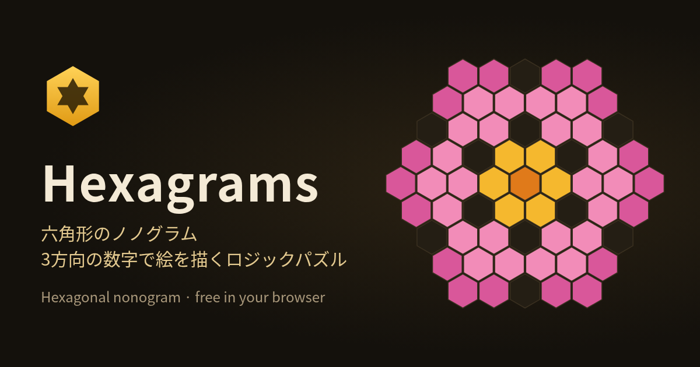

# Hexagrams

**遊ぶ:** https://pe-kun333.github.io/hexagrams/

六角形のマスで遊ぶ **ノノグラム型ロジックパズル** です。盤の外側にある3方向（横・右下がり・右上がり）の数字を手がかりにマスを塗っていくと、絵が現れます。



- 手作りの問題 19 問（初級・中級・上級）。どの問題も「列ごとの論理だけで答えが1つに決まる」ことをソルバーで確かめています
- ランダム生成（小・中・大・特大）。こちらも答えが1つに決まるものだけを出します
- ハードモード：数字の一部を「？」で隠します。隠したあとも答えが1つに決まる組み合わせだけを選んでいます
- スマホ対応：タップ・なぞり塗り、塗る／×印の切り替え、長押しで×印、2本指でズーム・移動
- キーボード操作：矢印キーで移動、Space で塗る、X で×印、Delete で消す、Ctrl+Z で戻す、+ / − / 0 でズーム
- 日本語／English 切り替え、遊び方の画面つき
- クリア後に「結果をコピー」（例：`Hexagrams #花 クリア 1:23 ノーミス`＋ページのURL）。自動で投稿することはありません
- **ピクチャークエスト（Picture Quest）**：好きな画像を六角形のドット絵に変換し、いくつものステージに分けて遊べます。全部解くと絵が完成します（下で説明）

## ピクチャークエスト

タイトル画面の「ピクチャークエスト」、またはサイドバーの「画像からパズルを作る」から始めます。

1. **画像を選ぶ**：ファイル選択、ドラッグ＆ドロップ、貼り付け（Ctrl+V / ⌘V）に対応しています。**画像はブラウザの中だけで処理し、どこにもアップロードしません**（大きな画像は長い辺が 1024px になるよう縮小してから処理します）
2. **変換を調整**（プレビューはすぐ反映されます）
   - 細かさ：小 約150マス／中 約350マス／大 約700マス
   - 1ステージの大きさ：標準（一辺4・最大37マス）／大きめ（一辺5・最大61マス）
   - 色：白黒、または 2〜4色（k-means で色を選び、外周にいちばん多い色を背景にします）
   - 白黒のとき：しきい値（大津の方法で自動設定し、スライダーで調整可）、反転
   - 強調：なし／コントラスト／コントラスト＋輪郭
3. **はじめる**：六角形のマップ（ハニカム）が開きます。灰色のステージを選んで解くと、その部分の絵が現れます。全部解くと絵が広がる演出のあと、**PNGで保存**できます。「元の色」表示や「元画像と比べる」もあります

**ステージの作り方**：絵全体を六角形の「六角形タイル」（一辺4または5）で敷き詰めます。端は欠けた形のステージになります（数字は、そのステージ内で途切れずに続くマスの並びごとにつきます）。各ステージは、列ごとの論理だけで答えが1つに決まるかをソルバーで確かめ、決まらない場合だけ**最初から開いているマス（点線の枠と点の印）**を最小限加えます。マスが6未満の小さな切れ端や、全部空白・全部同じ色のステージは自動でクリア済みになります。

**色つきステージ**：数字の背景色がその色を表します。違う色どうしの並びは間をあけずに隣り合うことがあります（同じ色どうしは必ず1マス以上あきます）。上のパレット（キー 1〜4）で塗る色を選びます。

**サンプル**：同梱のサンプル「気球」（このゲームのために描いたイラスト）ですぐ試せます。

**保存**：変換後のマス目・小さな縮小画像（比較用、240px 程度）・進み具合だけを localStorage（キー：`hexagrams.quests.v1`）に保存します。元の画像そのものは保存しません。容量が足りないときは縮小画像を省いて保存し、それでも無理ならページを閉じるまでの一時的なクエストとして遊べます（メッセージでお知らせします）。一覧から削除できます。

## ローカルで遊ぶ

ビルドは不要です。`index.html` をブラウザで開くだけで動きます。
クリップボードへのコピーなどをページ公開時と同じ条件で試したい場合は、簡単なサーバーで開いてください。

```sh
cd hexagrams
python3 -m http.server 8000
# → http://localhost:8000/ を開く
```

## GitHub Pages で公開する手順（まだ実施していません）

1. GitHub に新しいリポジトリを作る（例：`hexagrams`）
2. このフォルダの中身をリポジトリのルートに置いて push する
   ```sh
   git init && git add . && git commit -m "Hexagrams"
   git branch -M main
   git remote add origin https://github.com/<ユーザー名>/hexagrams.git
   git push -u origin main
   ```
3. リポジトリの **Settings → Pages** で「Deploy from a branch」、ブランチ `main`、フォルダ `/ (root)` を選んで保存
4. 数分後に `https://<ユーザー名>.github.io/hexagrams/` で公開されます
5. **公開URLが決まったら** `index.html` の `og:image` と `twitter:image` を絶対URL（例：`https://<ユーザー名>.github.io/hexagrams/og.png`）に書き換え、`<meta property="og:url" content="https://<ユーザー名>.github.io/hexagrams/">` を追加してください。SNS のカード表示は多くの場合、絶対URLでないと画像が出ません

`.nojekyll` は GitHub Pages の Jekyll 処理を止めるための空ファイルです（そのまま置いておけば大丈夫です）。

## ファイル構成

| ファイル | 内容 |
|---|---|
| `index.html` | ページ本体（メタタグ・画面の骨組み） |
| `style.css` | 見た目（スマホ用レイアウトを含む） |
| `core.js` | 盤の座標・数字の計算・ソルバー・難易度判定・ランダム生成（DOM なし。Node でも動きます） |
| `puzzles.js` | 手作り問題のデータ |
| `app.js` | 画面の操作・保存・多言語・遊び方 |
| `quest-core.js` | ピクチャークエストの計算（画像→六角マス、しきい値・色分け、ステージ分割、色つきソルバー、開始マスの追加。DOM なし） |
| `quest.js` | ピクチャークエストの画面（取り込み・プレビュー・マップ・完成演出・PNG保存） |
| `sample.js` | サンプル画像（自作イラスト、data URL で埋め込み） |
| `favicon.svg` / `favicon-32.png` / `apple-touch-icon.png` | アイコン |
| `og.png` | SNS 用の画像（1200×630） |
| `screenshots/` | 確認用のスクリーンショット（公開には不要。消してもかまいません） |

## プライバシー

- 進み具合・ベストタイム・設定は、このブラウザの **localStorage** にだけ保存します（キー：`hexagrams.v1`、ピクチャークエストは `hexagrams.quests.v1`）。「設定 → 保存データを消去」で消せます
- ピクチャークエストで選んだ画像は、端末のブラウザの中だけで処理します。サーバーには送りません
- 外部への通信はしません。アクセス解析・広告・外部フォント・CDN は使っていません

## ライセンス

MIT License（© 2026 hihumi mihune）。`LICENSE` を見てください。

---

## English

**Play:** https://pe-kun333.github.io/hexagrams/

**Hexagrams** is a hexagonal nonogram — a logic puzzle where numbers along three directions (rows, down-right and up-right diagonals) tell you the runs of filled cells; solving every line reveals a picture.

- 19 hand-made puzzles (Easy / Medium / Hard), each verified to have a unique solution reachable by line logic alone, plus a random generator with the same guarantee
- Hard mode hides some clues ("?") while keeping the solution unique
- Touch support (tap / drag, Fill ⇄ Mark toggle, long-press to mark, pinch to zoom), keyboard play, Japanese / English UI
- "Copy result" after a clear (nothing is posted automatically)
- **Picture Quest**: turn any picture (file, drag & drop or paste) into hex pixel art split into stages; clear every stage to reveal the picture. Images are processed entirely in your browser and never uploaded. Options: detail S/M/L (~150/~350/~700 cells), stage size (side 4 or 5), B/W with Otsu auto-threshold + slider + invert, or 2–4 colours (k-means) with coloured clues, contrast/edge enhancement, live preview. Each stage is checked to be uniquely solvable by line logic; if not, a minimal set of pre-revealed cells (dotted outline) is added. Tiny, empty or single-colour stages auto-clear. Honeycomb map with progress, reveal animation, PNG export, original-vs-pixel-art comparison, and a built-in sample quest. Only the converted grid, a ~240px thumbnail and progress are stored (`hexagrams.quests.v1`); quota errors are handled gracefully

**Run locally:** open `index.html`, or run `python3 -m http.server` in this folder.
**Deploy:** push the folder to a GitHub repo and enable *Settings → Pages → Deploy from a branch (main, / root)*. Then change `og:image` / `twitter:image` to absolute URLs and add `og:url`.
**Privacy:** progress is stored only in your browser's localStorage; no network requests, no analytics.
**License:** MIT © 2026 hihumi mihune.
